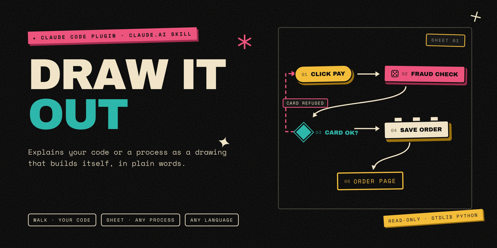
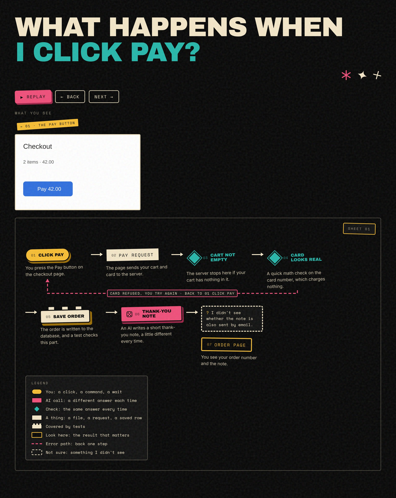
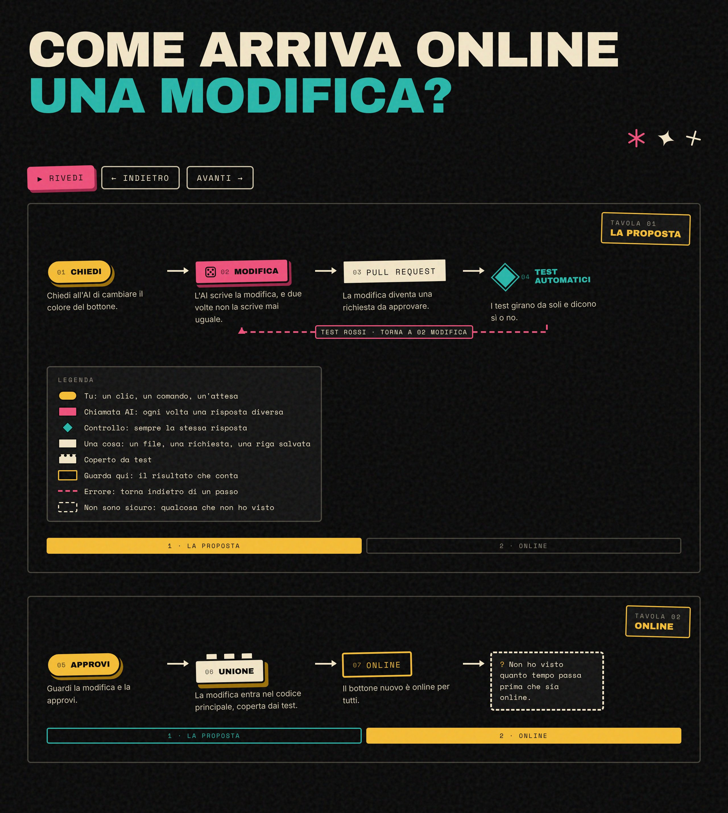
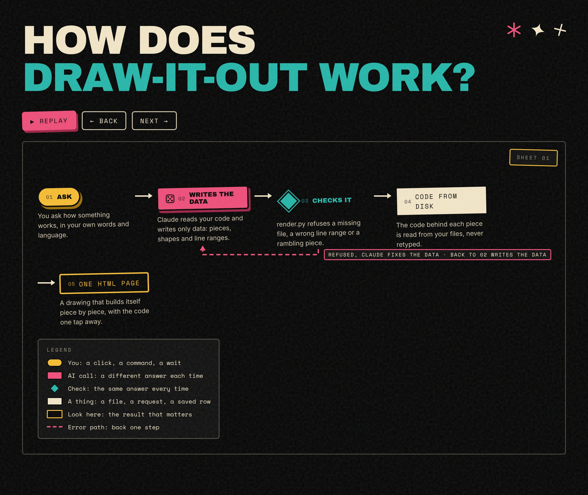

<p align="center">
  
</p>

<p align="center">
  <a href="LICENSE"></a>
  
  
  
</p>

**draw-it-out** explains how something works as a drawing that builds itself, piece by piece,
in plain words. It is made for people who build software with AI and don't read the code: ask
"what happens when I click Pay?" and get one page that walks you through it, with the real code
one tap away.

| Mode | You ask | You get |
|---|---|---|
| **walk** | "What happens when I click Pay?" | The real path through *your* code, from the click to what you see, each step backed by the exact lines on disk and, optionally, real screenshots of your app. |
| **sheet** | "Explain how our release process works." | Any process (a pipeline, an agent loop, a business flow) drawn as one or more sheets. Code is optional. |

The page is written in the language you asked in.

## See it

<p align="center">
  
</p>

The bundled walk example, fully built. In the browser the pieces appear one at a time in story
order; ▶ Replay, ← Back and Next → step through it, and tapping a piece opens the code behind it.

<details>
<summary><b>A process sheet, in Italian, split in two parts</b></summary>
<br>
<p align="center">
  
</p>
</details>

## Install

### Claude Code

```bash
claude plugin marketplace add nicodiansk/draw-it-out
```

```bash
claude plugin install draw-it-out@draw-it-out
```

Then ask your question in plain words, or run `/draw-it-out:explain`.

### claude.ai

Build the skill zip, then upload `dist/draw-it-out-explain.zip` in **Settings → Skills**:

```bash
bash scripts/pack.sh
```

The zip holds the skill, its renderer and the examples. The screenshot tool stays out: it
needs a local browser.

### Screenshots of your app (optional, Claude Code only)

```bash
pip install playwright && python3 -m playwright install chromium
```

Without Playwright the walk is drawn from the code alone.

## Use it

Ask the way you would ask a colleague:

- "What happens when I click Pay?"
- "Where does my signup form send the data?"
- "Draw how our nightly import works."
- "Spiegami come funziona il deploy." (the page comes back in Italian)

Claude asks at most three short questions, reads what it needs, and hands you one HTML page:
published as an artifact where that is available, otherwise opened in your browser.

## The drawing

One shape, one meaning, on every sheet:

| Shape | Means |
|---|---|
| Mustard pill | You: a click, a command, a wait |
| Pink box with a die | An AI call: a different answer each time |
| Teal diamond | A check: the same answer every time |
| Paper box | A thing: a file, a request, a saved row |
| Paper block with studs | A piece covered by tests |
| Mustard outline | Look here: the result that matters |
| Dashed pink arrow | The error path: where you go back when a check fails |
| Dashed box | A gap: something Claude did not see and says so |

Up to 20 pieces per sheet; longer stories are split into several sheets with a stage bar.

## How it works

<p align="center">
  
</p>

The diagram above was drawn by draw-it-out from
[`docs/readme/how-it-works.json`](docs/readme/how-it-works.json).

- **Claude writes only data.** A JSON file names the pieces, their shapes, the order and, for
  code, a file and a line range. The full format is in
  [`skills/explain/schema.md`](skills/explain/schema.md).
- **The renderer checks it.** [`render.py`](skills/explain/engine/render.py) (Python standard
  library, no dependencies) refuses a missing file, a line range that doesn't exist, a path
  outside your project, an unknown shape, a piece longer than one sentence, more than 20 pieces
  on a sheet and a loop in the order. Each refusal is one line, `field → problem → how to fix`,
  and Claude corrects the data and runs it again.
- **Code is never retyped.** The lines shown under each piece are read from your files at
  render time, exactly as they are on disk.
- **One self-contained HTML file.** Data, code and screenshots are embedded; fonts load from
  Google Fonts and fall back to system fonts offline.

## Read-only by design

- Your project is only read: nothing in it is edited. The JSON and the page are written to a
  folder outside it.
- The optional screenshot tool opens `localhost` only and lets through only `GET` and `HEAD`
  requests to it. Popups, WebSockets and service workers are blocked, so a click on Pay shows
  the page and sends nothing.
- It never signs in and never asks you to.

## Languages

English and Italian are built in. For any other language Claude translates the page's few
interface words (buttons, legend) and the renderer checks that every one is there.

## Development

```bash
python3 -m unittest discover -s tests -v
```

The browser tests run when Playwright and Chromium (or Chrome) are installed and skip otherwise.

| Task | Command |
|---|---|
| Accept a deliberate template change | `UPDATE_SNAPSHOTS=1 python3 -m unittest discover -s tests`, then review `tests/snapshots/` |
| Rebuild the README images | `python3 scripts/readme_images.py` (Playwright and Pillow) |
| Build the claude.ai zip | `bash scripts/pack.sh [out-dir]` |

```
.claude-plugin/        plugin and marketplace manifests, icon
skills/explain/        the skill: SKILL.md, walk.md, sheet.md, schema.md
  engine/              render.py, template.html, capture.py (Claude Code only)
  examples/            walk.json, sheet.json and the tiny shop app they explain
tests/                 unittest suite and HTML snapshots
scripts/               pack.sh, readme_images.py
docs/                  design, implementation plan, README sources
```

Changes are listed in [CHANGELOG.md](CHANGELOG.md).

## License

[MIT](LICENSE)
